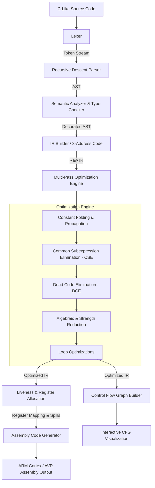

# ⚡ Code Optimization Framework for Embedded Systems

[](https://fastapi.tiangolo.com)
[](https://reactjs.org/)
[](https://www.typescriptlang.org/)
[](https://vitejs.dev/)
[](https://arm.com)
[](LICENSE)

An end-to-end educational and analytical compiler suite tailored for resource-constrained embedded microcontrollers. 

This framework takes C-like source code through lexical analysis, parsing, semantic verification, intermediate representation (3-Address Code), AST construction, graph-coloring register allocation, target assembly generation (ARM Cortex-M4/M0+, AVR ATmega328P), and multi-pass optimization pipelines — all visualized in real-time through an interactive web-based IDE.

---

## 📸 Overview & Key Highlights

- **Visual Multi-Stage Pipeline**: Inspect the full compilation lifecycle step-by-step:
  - 🔍 **Tokens & Lexer Output**
  - 🌳 **Abstract Syntax Tree (AST)**
  - 🔄 **Linear Three-Address Code (TAC / IR)**
  - 🕸️ **Control Flow Graphs (CFG)** via Mermaid diagrams
  - 📊 **Register Allocation & Spilling Maps**
  - ⚙️ **Unoptimized ($O_0$) vs Optimized ($O_1/O_2$) Assembly Diff**
- **Pluggable Optimization Passes**: Toggle passes on the fly to see exact code transformations:
  - Constant Folding & Constant Propagation
  - Dead Code Elimination (DCE)
  - Common Subexpression Elimination (CSE)
  - Algebraic Simplifications
  - Strength Reduction (e.g. replacing costly multiplications/divisions with shifts)
  - Loop Optimizations (Loop unrolling / invariant motion)
- **Embedded Target Profiles**:
  - **ARM Cortex-M4**: 32-bit RISC, 16 registers, hardware DSP/FPU considerations.
  - **ARM Cortex-M0+**: 32-bit ultra-low power RISC.
  - **AVR ATmega328P**: 8-bit Harvard architecture, 32 registers.
- **Resource Profiler & Timings**: Real-time analysis of instruction counts, estimated cycle count, stack spill space, and phase-by-phase execution timings.

---

## 🏗️ Architecture & Pipeline Flow



---

## 📁 Repository Structure

```text
compiler-capstone/
├── backend/
│   ├── api/
│   │   └── main.py              # FastAPI endpoints (/api/compile, /api/hardware)
│   ├── compiler/
│   │   ├── lexer.py             # Lexical analyzer / tokenizer
│   │   ├── parser.py            # AST parsing
│   │   ├── semantic.py          # Semantic & type checking
│   │   ├── ir_builder.py        # 3-Address Intermediate Code generator
│   │   ├── optimizer.py         # Multi-pass optimization routines
│   │   ├── register_alloc.py    # Liveness analysis & register allocation
│   │   ├── codegen.py           # Target machine code emitter (ARM / AVR)
│   │   └── analysis.py          # Static resource & instruction metrics
│   └── requirements.txt         # Python dependencies
├── frontend/
│   ├── src/
│   │   ├── components/          # Pipeline visualizer components
│   │   │   ├── TokensView.tsx   # Token table & details
│   │   │   ├── ASTView.tsx      # Interactive AST tree
│   │   │   ├── IRView.tsx       # Pre & Post Optimization IR
│   │   │   ├── CFGView.tsx      # Mermaid Control Flow Graph
│   │   │   ├── AssemblyView.tsx # Assembly output inspection
│   │   │   ├── AssemblyDiffView.tsx # Side-by-side assembly diff (O0 vs Opt)
│   │   │   ├── MetricsPanel.tsx # Cycle count, instructions, spill stats
│   │   │   └── TimingsPanel.tsx # Millisecond compilation phase profile
│   │   ├── App.tsx              # Main IDE interface & Monaco Editor integration
│   │   └── api.ts               # Backend client services
│   ├── package.json             # React, Vite, Monaco & Tailwind config
│   └── vite.config.ts
├── start.bat                    # One-click Windows startup script
└── README.md
```

---

## 🚀 Getting Started

### Prerequisites

- **Python**: `>= 3.10`
- **Node.js**: `>= 18.0` (with `npm`)

---

### Quick Start (Windows)

Simply run the included batch script to launch both services and automatically open your browser:

```bat
start.bat
```

---

### Manual Setup

#### 1. Backend Setup (FastAPI)

```bash
# Navigate to the backend directory
cd backend

# Create and activate a virtual environment (optional but recommended)
python -m venv venv
# On Windows:
venv\Scripts\activate
# On Linux/macOS:
source venv/bin/activate

# Install dependencies
pip install -r requirements.txt

# Start the API server
python -m uvicorn api.main:app --host 127.0.0.1 --port 8000 --reload
```
API Documentation will be live at: [http://127.0.0.1:8000/docs](http://127.0.0.1:8000/docs)

#### 2. Frontend Setup (React + Vite)

```bash
# In a separate terminal, navigate to the frontend directory
cd frontend

# Install dependencies
npm install

# Start Vite dev server
npm run dev
```
Open your browser at: [http://localhost:5173](http://localhost:5173)

---

## 🧪 Optimization Showcases

### 1. Algebraic & Strength Reduction
Transforming costly operations into ultra-fast shift/add sequences:
```c
// Source
int x = a * 8;
int y = b / 4;

// Optimized Assembly (ARM)
LSL R1, R0, #3      @ Replaced multiplication with left shift
ASR R2, R1, #2      @ Replaced division with arithmetic right shift
```

### 2. Constant Folding & Dead Code Elimination
```c
// Source
int a = 10;
int b = a + 5;
int dead_var = 999;
return b * 2;

// Generated Output:
// 'dead_var' is eliminated; 'a + 5' and 'b * 2' are folded into immediate constants.
MOV R0, #30
BX LR
```

---

## 🛠️ Tech Stack

| Domain | Technologies |
|---|---|
| **Frontend** | React 19, TypeScript, Vite, Monaco Editor, Tailwind CSS, Lucide Icons, Mermaid.js, Recharts |
| **Backend** | Python 3, FastAPI, Uvicorn, SQLite, Pydantic |
| **Compiler Engineering** | Lexical Analysis, Recursive Descent Parser, 3AC / SSA IR, Graph Coloring Register Allocation |
| **Target Architectures** | ARM Cortex-M4, ARM Cortex-M0+, Atmel AVR (ATmega328P) |

---

## 🤝 Contributing

Contributions, issues, and feature requests are welcome!
Feel free to check the [issues page](../../issues).

1. Fork the Project
2. Create your Feature Branch (`git checkout -b feature/AmazingOptimization`)
3. Commit your Changes (`git commit -m 'Add some AmazingOptimization'`)
4. Push to the Branch (`git push origin feature/AmazingOptimization`)
5. Open a Pull Request

---

## 📜 License

Distributed under the MIT License. See `LICENSE` for more information.
